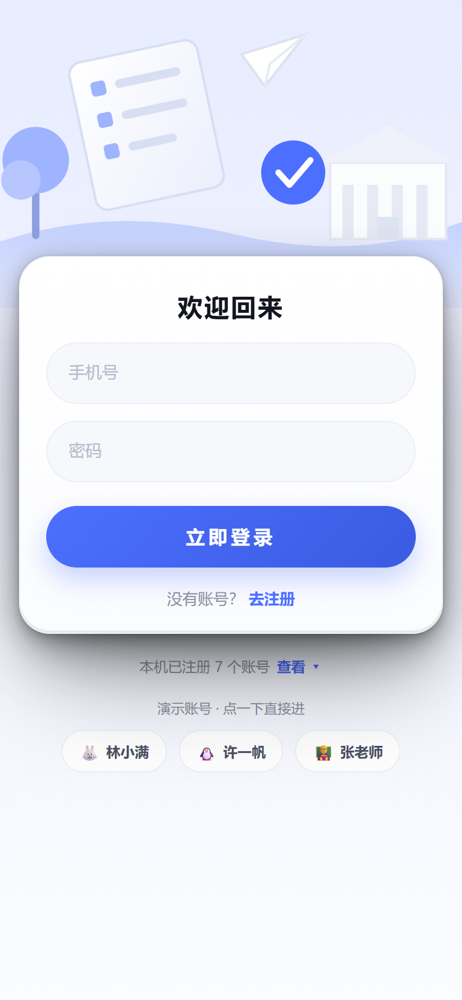
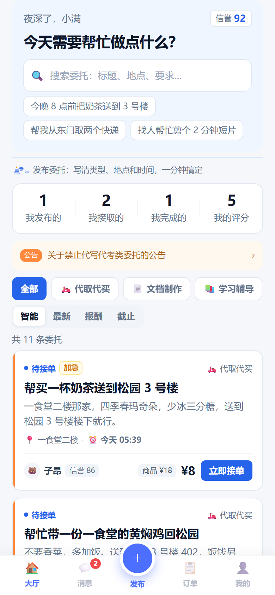
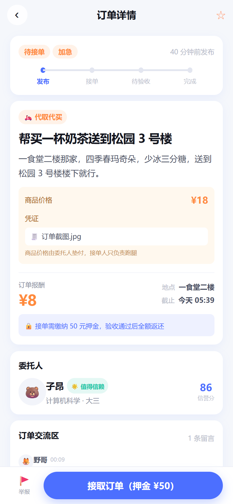
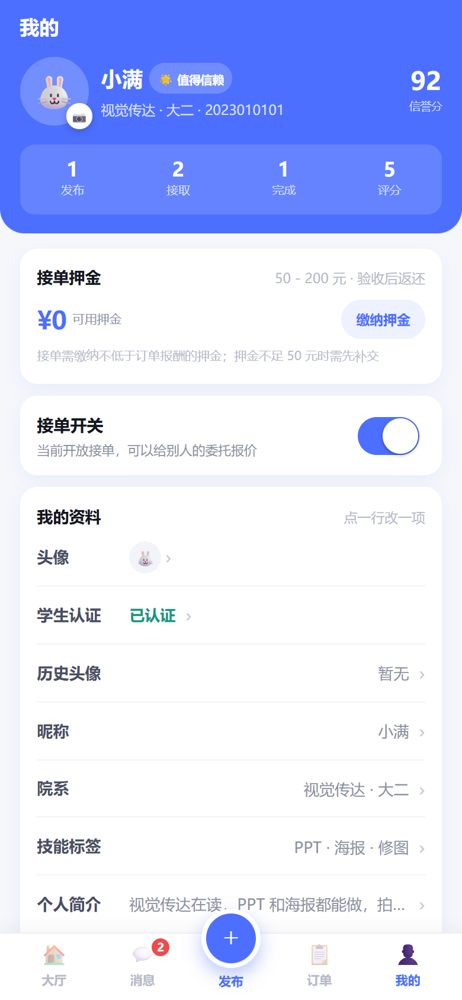
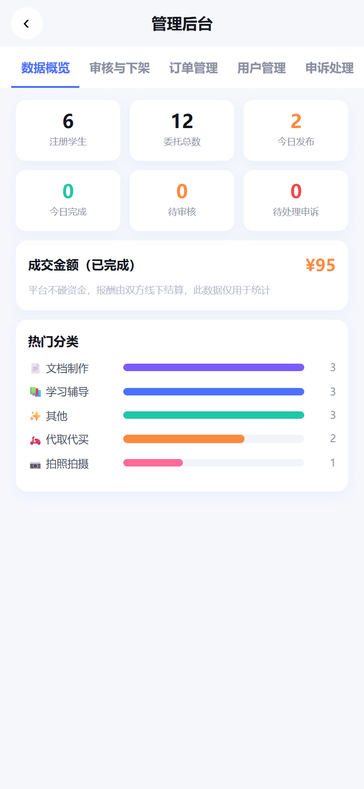

# 校园委托 · Campus Commission

> 仅限本校学生的小额校园互助平台：发一条订单，自由接单，押金保障，信用沉淀。

一个跑在浏览器里的校园委托平台，包含**学生端**和**管理员后台**两套角色，覆盖发单、自由接单、交付、验收、评价、押金、纠纷仲裁的完整闭环。

<p align="center">
  
  
  
  
  
</p>

---

## 快速开始（10 分钟极速复现）

> 环境：Node.js ≥ 22、npm ≥ 10；无需数据库，前端无需环境变量。

```bash
npm install
npm run dev:h5        # 本地开发，浏览器打开终端提示的地址
# 或
npm run build:single  # 生成「校园委托-单文件版.html」，双击即开、离线可用
```

登录页点演示账号 **林小满 / 许一帆 / 张老师** 直接进入（无需注册）。

- 依赖清单与完整复现步骤见 [`复现指南.md`](复现指南.md)
- 技术文档：[`docs/技术文档.pdf`](docs/技术文档.pdf)
- AI 协作记录（Prompt 快照）：[`docs/AI-协作记录.md`](docs/AI-协作记录.md)
- 演示视频脚本：[`docs/演示视频脚本.md`](docs/演示视频脚本.md)

---

## 一、核心规则

| 规则 | 说明 |
|---|---|
| **只做小额** | 单笔订单报酬上限 **200 元**，代取类商品价格上限 **200 元** |
| **自由接单** | 没有竞价报价，任何符合条件的同学都能直接接单，先接先得 |
| **押金保障** | 接单需缴纳押金：**最低 50、最高 200，且不低于订单报酬**；验收通过后全额返还；被客诉且申诉成立按情节扣除 |
| **订单交流区** | 每条订单有公开留言区，接单前可以先问细节，所有登录用户可见可发 |
| **发布即上架** | 含违规词（代考/代写/代刷课）的委托在发布时直接拦截；合规内容立即上架，所有人可见。管理员可随时抽查下架 |
| **学号门槛** | 学号**选填**，不填也能注册和浏览；但发单/接单前必须补填并通过手机验证 |
| **平台不碰资金** | 报酬线下自行结算（微信 / 支付宝），平台只记账与管控流程 |

**押金细则**：接单时从押金余额扣除并冻结；验收通过全额返还；押金不足 50 元时需先补交才能继续接单。申诉成立时按冻结押金的 50%（最低 10 元）扣罚，剩余返还。

## 二、两类角色

| 角色 | 能做什么 |
|---|---|
| **学生** | 发单、接单、缴押金、交付、验收、评价、申诉、管理作品集、钱包与收入流水 |
| **管理员** | 审核订单、封禁账号、仲裁纠纷、管理分类、查看数据、发布公告 |

## 三、功能清单

### 1. 账号

- **注册**：只需**用户名**（2-12 位）+ **手机号**（11 位）+ 密码；**学号选填**。不要求校园邮箱，注册后即可浏览
- **登录**：用户名 / 手机号 / 学号 任填其一 + 密码，或手机验证码（演示码 123456）；旧账号（无用户名字段）会自动迁移，仍可登录
- **登录页视觉**：校园插画背景（内联 SVG）+ 米白卡片 + 绿色主按钮
- **手机端与桌面端是两套布局**（按窗口宽度 900px 分流）：桌面端是横版卡片 + 右侧「轻量任务」插画；手机端是竖版——顶部「清单 + 纸飞机 + 教学楼」插画、白色卡片、协议勾选、底部返回登录
- **桌面端主界面**：左侧固定导航栏（232px），内容区**铺满侧栏右侧**（左右各留 28px），不再有 100px+ 的空白走廊；手机端保持底部 TabBar，两套自动切换
- **筛选栏**：分类 chip 一行 + 右侧分段排序（智能/最新/报酬/截止），楼栋收进 `showActionSheet` 弹层；下方一行「共 N 条委托」+ 可点掉的筛选标签
- **任务卡片**：桌面端**双列网格**（`repeat(2, minmax(360px,1fr))`），卡片 1px 边框 + 12px 圆角 + 左侧 3px 类型色条 + hover 蓝边；状态用「小圆点 + 文字」只出现一次，右下角**唯一主按钮「立即接单」**；价格用中性深色 `#0F172A`，红色只留给「已流单」；截止时间三档着色（<30 分钟橙、<24 小时中性、更久灰）
- **补填学号**：需要注册手机号 + 验证码校验，学号全局唯一
- **个人资料**：主页上「我的资料」一行一项（头像 / 昵称 / 院系 / 技能标签 / 个人简介 / 学号），**点哪项改哪项**，在弹层里改，不占主页空间
- **技能标签**：内置 30 个现成标签（取快递 / PPT / 高数辅导 / 视频剪辑…）点选即可，也能自己输入；**单个标签最多 4 个字，最多选 8 个**，自动去重
- **自定义头像**：**直接点头像**就弹出更换选项（相册 / 文件 / emoji / 恢复默认）。上传的图片会先用 canvas 压到 320px、约 40 KB 再存 base64，手机原图（几 MB）也能一次成功
- **接单开关**：随时暂停接单

### 2. 委托人

- **发布订单**：**先选类型** → 填标题、描述、报酬（≤200）、交付地点、楼栋、截止时间、附件、加急、匿名
- **代取代买类额外要求**：必须填商品价格（≤200）并上传凭证（订单截图 / 小票）
- **订单管理**：待接单 → 已接单 → 进行中 → 待验收 → 已完成 / 已取消
- **订单交流区**：公开留言，接单人和其他同学都能问
- **验收与评价**：验收后双方信誉分 +2、接单人押金返还，然后互相评价
- **取消订单**：未完成前可取消，扣 2 分信用
- **发起申诉**：交付不符、逾期未交付可申请管理员仲裁

### 3. 接单人

- **大厅浏览**：分类筛选、楼栋筛选、关键词搜索、四种排序
- **自由接单**：押金足够可直接接；不够会弹出补交弹层
- **我的接单**：进行中 / 已完成订单
- **提交交付**：选择文件或填写交付说明
- **作品展示**：上传案例，技能类订单更容易被选中
- **收藏**：收藏订单、关注靠谱的同学

### 4. 消息

- **订单交流区**：每条订单一个公开留言区（详情页内）
- **私聊**：一对一聊天，支持文字与图片，附快捷回复
- **好友**：互相加好友，好友之间私聊不限次数
- **临时聊天限制**：非好友之间累计最多 **10 句**，顶部实时显示剩余句数，用完锁住输入并提示加好友
- **系统通知**：有人接单、已交付待验收、审核结果、收到评价、好友申请、纠纷处理、平台公告

### 5. 首页

- 顶部是**卡通插图**（内联 SVG，离线可用）+ 问候语 + 信誉分
- 四项统计与**个人主页完全一致**：我发布的 / 我接取的 / 我完成的 / 我的评分
- 搜索、分类横滑、楼栋筛选、四种排序、公告条

### 6. 钱包与收入

- **累计收入 / 累计支出 / 净收入** 三个数字
- **每笔来源**：哪条订单、哪天、接单收入还是发单支出、押金扣罚
- 他人主页展示「累计接单收入」作为可信度参考

### 7. 信誉与评价

| 行为 | 信誉分变化 |
|---|---|
| 完成订单并验收 | 双方各 +2 |
| 收到 4-5 星评价 | 被评价方 +3 |
| 收到 1-2 星评价 | 被评价方 −3 |
| 发布后单方面取消 | 发布者 −2 |
| 申诉成立（接单人违约） | 接单人 −5，并从押金扣罚 |

新注册账号默认 **100 分**。等级：`≥95 校园之星 👑` / `≥85 值得信赖 🌟` / `≥70 靠谱同学 ✅` / `≥60 成长中 🌱` / `<60 新同学 🆕`

**信誉分低于 60 会被限制发单和接单。**

### 8. 管理员后台

| 模块 | 能力 |
|---|---|
| 数据概览 | 注册学生、订单总数、今日发布/完成、待审核、待处理申诉、成交金额、热门分类 |
| 委托审核 | 待审队列，通过上架 / 驳回（必须填原因） |
| 订单管理 | 全部订单按 6 种状态筛选，点进详情 |
| 用户管理 | 搜索、查看信用与押金、封禁 / 解封 |
| 申诉处理 | 驳回申诉 / 判定违约（扣 5 分 + 押金扣罚） |
| 分类管理 | 新增、删除分类 |
| 公告发布 | 发布公告并推送给所有学生 |

### 9. 平台规则与帮助

独立规则页：六组规则条目 + 平台公告 + 6 条常见问题折叠问答。

## 四、订单状态机

```
pending 待接单 ──缴押金接单──▶ assigned 已接单 ──开始──▶ working 进行中
                                                          │ 提交交付
                        done 已完成 ◀──验收── submitted 待验收
未完成状态可被委托人取消 ──▶ cancelled 已取消（扣 2 分，押金返还）
```

**审核独立于订单状态**：`audit = pending / approved / rejected`，只有 `approved` 才出现在大厅。

## 五、账号仓库（持久化）

账号单独存放在一个**独立仓库**里，与业务数据分开：

| 存储键 | 内容 |
|---|---|
| `campus_commission_state_v2` | 业务数据（订单、消息、评价、通知…） |
| `campus_commission_accounts_v1` | **账号仓库**（身份与资料字段） |

意义：清空业务数据、重置演示数据、应用更新，**已注册账号都不会丢**，仍然可以登录。仓库带版本号（当前 v2）和迁移逻辑，字段升级不会让老账号失效。

> 这是本地持久化。真正的跨设备登录需要后端数据库——见文末「已知限制」。

## 六、技术栈与选型理由

| 选择 | 理由 |
|---|---|
| **uni-app + Vue 3 + Vite** | 一套代码编译到 H5 与微信小程序；H5 用于评审和预览 |
| **纯前端 + 本地存储 + 独立账号仓库** | 零后端依赖、可离线。业务规则全部收敛在数据层，换后端只需替换 `store.js` |
| **自绘导航栏与 TabBar** | 状态栏高度自适应；TabBar 支持中间悬浮发布按钮与未读红点 |
| **CSS 变量做设计令牌** | 主色、圆角、阴影收敛到 `App.vue`，页面里不硬编码色值 |
| **零图片资源** | 图标全 emoji，字体用系统栈，构建产物小 |

## 七、目录结构

```
campus-commission/
├─ 校园委托-单文件版.html      ★ 单个文件，双击即开的完整应用
├─ index.html                 H5 开发入口
├─ vite.config.js             端口 5180；UNI_SINGLE_FILE=1 时关闭代码分割
├─ scripts/
│  ├─ flow2.js                全链路：接单(押金)→交付→验收→评价→信誉分（15 项）
│  ├─ flow3.js                主页 / 换头像 / 真实选文件 / 订单管理（12 项）
│  ├─ flow4.js                钱包 / 好友 / 临时聊天 10 句限制（20 项）
│  ├─ flow5.js                学号门槛 / 押金 / 凭证 / 账号仓库（16 项）
│  ├─ reg.js                  注册校验与唯一性（9 项）
│  ├─ shots.js                全站截图 + 控制台错误收集
│  ├─ build-single.js         一键产出单文件版
│  ├─ inline.js               把 H5 产物内联成单个 HTML
│  ├─ pack.py                 打提交包
│  └─ dbg.js                  运行时错误定位
├─ preview/                   截图产物
└─ src/
   ├─ App.vue                 全局设计令牌 + 通用样式
   ├─ pages.json              12 个页面
   ├─ utils/
   │  ├─ constants.js         分类（含代取类标记）、状态机、审核、信用、楼栋、违规词、押金规则、平台规则
   │  ├─ seed.js              7 个账号 + 12 条订单 + 消息/通知/申诉/公告/作品/好友/账本
   │  ├─ vault.js             ★ 账号仓库（独立存储 + 版本迁移）
   │  ├─ file.js              文件选择 / 图片转 base64
   │  └─ store.js             ★★ 全部业务逻辑（唯一数据出入口）
   ├─ components/             AppHeader / TabBar / TaskCard / EmptyState
   └─ pages/
      login / hall / detail / publish / orders / chat / room / mine / review / admin / profile / rules
```

## 八、如何运行

### 最省事：单文件版（双击即开）

根目录的 **`校园委托-单文件版.html`** 是完整应用的单个 HTML 文件，JS / CSS 已全部内联：

- 双击就能打开，不需要 Node、不需要装依赖、不需要起服务器、不需要联网
- 建议按 `F12` 切到手机视图（390×844）

重新生成：`npm run build:single`

### 开发模式

```bash
npm install
npm run dev:h5
```

打开 `http://127.0.0.1:5180/#/pages/hall/hall`。

### 自动化验证

```bash
node scripts/shots.js    # 全站 17 页截图 + 错误收集（需先启动 dev:h5）
node scripts/flow2.js    # 全链路 15 项
node scripts/flow3.js    # 主页 / 头像 / 选文件 / 订单管理 12 项
node scripts/flow4.js    # 钱包 / 好友 / 临时聊天 20 项
node scripts/flow5.js    # 学号门槛 / 押金 / 凭证 / 账号仓库 16 项
node scripts/flow6.js    # 默认信誉分 / 头像上传 / 首页一致性 / 卡通图 9 项
node scripts/flow8.js    # 技能标签：现成选择 / 自定义 / 4 字上限 / 8 个上限 15 项
node scripts/flow9.js    # 点头像换头像（1.8 MB 大图压缩）/ 点一行改一项 13 项
node scripts/flow10.js   # 手机号搜好友 / 手机端协议门槛 / 桌面端免勾选 16 项
node scripts/reg.js      # 注册校验 9 项
```

### 打提交包

```bash
python scripts/pack.py
```

## 九、演示账号

| 账号 | 密码 | 角色 | 说明 |
|---|---|---|---|
| `2023010101` | `123456` | 学生 林小满 | 有 ¥45 收入流水、押金 0 |
| `13800000006` | `123456` | 学生 许一帆 | **未填学号**，用来演示学号门槛 |
| `2024010303` | `123456` | 学生 苏晴 | 押金 0，可演示补交押金 |
| `2021010404` | `123456` | 学生 周野 | 押金 120 |
| `admin` | `admin888` | 管理员 张老师 | 后台全部权限 |

其余账号密码均为 `123456`。验证码登录的演示验证码固定为 **123456**。

## 十、演示脚本（约 3 分钟）

1. **学号门槛**：用 `13800000006` 登录 → 打开任意订单 → 底部按钮显示「请先完成学号填写」→ 点击 → 去填写 → 填学号 + 手机 + 验证码 → 绑定成功
2. **押金接单**：退出，用 `2024010303`（苏晴，押金 0）登录 → 打开「求一位会剪视频的同学」→ 点「接取订单（押金 ¥100）」→ 弹出补交弹层 → 缴纳并接单 → 押金冻结
3. **交流与交付**：在订单交流区留言 → 开始处理 → 提交交付成果
4. **验收与返还**：退出，用 `2021010404`（周野，委托人）登录 → 验收并确认完成 → 苏晴押金返还 → 双方信誉分 +2 → 评价
5. **发布校验**：用 `2023010101` 登录 → 发布页先选「代取代买」→ 只填报酬不传凭证 → 提交按钮置灰；报酬填 250 → 同样置灰
6. **审核**：正常发布一条 → 提示等待审核 → 用 `admin` 登录后台 → 委托审核 → 通过上架
7. **账号仓库**：注册一个新账号 → 在「我的」里重置演示数据 → 退出 → 新账号仍能登录

## 十一、已知限制

**数据存在浏览器本地存储（localStorage）**：

- 同一台设备、同一个浏览器里所有账号数据打通，可以完整演示双角色闭环
- 换设备或换浏览器数据不共享——**这不是一个真正的多用户线上系统**
- 账号有独立仓库，应用更新和业务数据重置不会丢账号；但清浏览器数据仍会丢

**押金是模拟记账**：缴纳押金不接真实支付，只在本地余额里加减。真实上线需要接入支付与资金存管。

**附件只记录文件名 / 大小 / 类型**，文件本身没有上传；聊天图片转 base64 存本地（单张 ≤260 KB）。

要变成真正多人可用，需要接入后端（数据库 + 账号体系 + 支付 + 对象存储）。当前代码已经把全部业务逻辑收敛在 `src/utils/store.js`，页面不直接碰存储，替换数据层即可迁移。

---

**技术栈**：uni-app · Vue 3 · Vite ｜ **页面**：12 个 ｜ **角色**：学生 / 管理员 ｜ **数据**：本地存储 + 独立账号仓库
